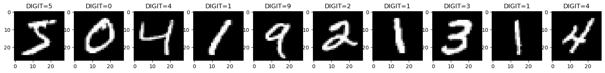
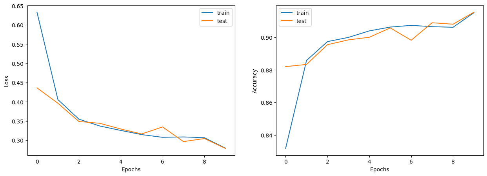
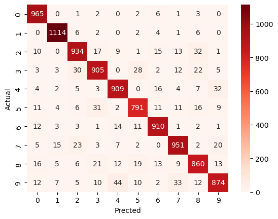
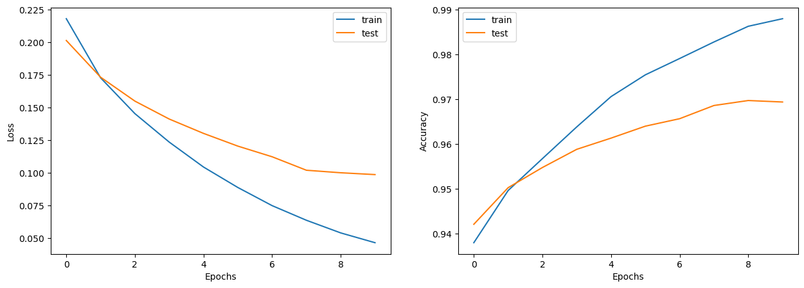
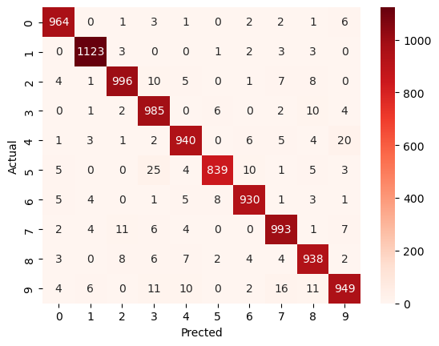
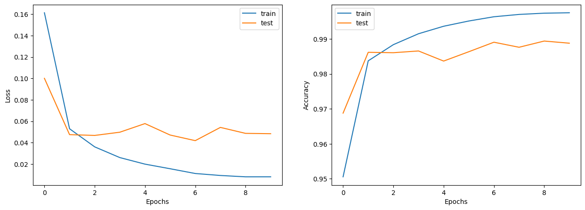
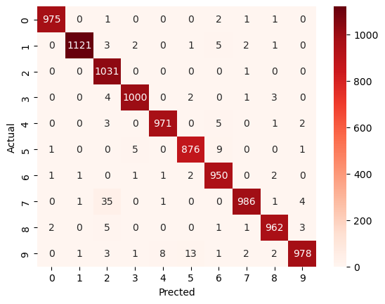
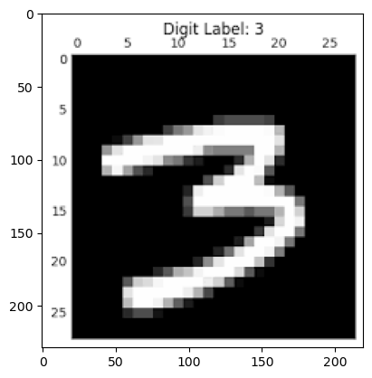
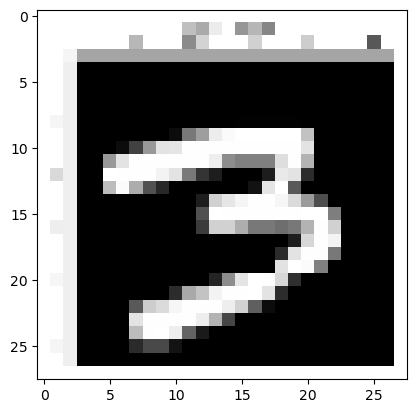

# 🧠 MNIST Handwritten Digit Classification (Deep Learning)

[](https://www.python.org/)
[](https://www.tensorflow.org/)
[](https://keras.io/)
[](LICENSE)

Projet complet de Deep Learning comparant différentes architectures de réseaux de neurones (**ANN** vs **CNN**) pour la reconnaissance automatique de chiffres manuscrits à partir du célèbre jeu de données **MNIST**. 

Ce projet met en évidence l'impact de la **mise à l'échelle des données (Feature Scaling)**, l'efficacité des **réseaux convolutifs (CNN)**, et démontre l'inférence en conditions réelles sur une image externe personnalisée via **OpenCV**.

---

## 📑 Table des Matières

- [Aperçu du Dataset](#-aperçu-du-dataset)
- [Architectures des Modèles](#-architectures-des-modèles)
- [Résultats & Comparatif des Performances](#-résultats--comparatif-des-performances)
- [Captures & Courbes d'Entraînement](#-captures--courbes-dentraînement)
  - [1. ANN sans mise à l'échelle (Baseline)](#1-ann-sans-mise-à-léchelle-baseline)
  - [2. ANN avec Feature Scaling (Normalisé)](#2-ann-avec-feature-scaling-normalisé)
  - [3. Réseau Convolutif (CNN)](#3-réseau-convolutif-cnn)
- [Inférence sur Image Externe](#-inférence-sur-image-externe)
- [Structure du Projet](#-structure-du-projet)
- [Installation & Démarrage](#-installation--démarrage)
- [Utilisation des Modèles Pré-entraînés](#-utilisation-des-modèles-pré-entraînés)

---

## 📊 Aperçu du Dataset

Le jeu de données **MNIST** (*Modified National Institute of Standards and Technology*) est composé de :
- **60 000 images** d'entraînement en niveaux de gris ($28 \times 28$ pixels).
- **10 000 images** de test réparties uniformément sur 10 classes (chiffres de `0` à `9`).



---

## 🏗️ Architectures des Modèles

### 1. Perceptron Multicouche (ANN - Baseline)
* **Entrée** : Image $28 \times 28$ aplatie en vecteur de dimension $784$.
* **Couche cachée** : Dense (100 neurones, activation `sigmoid`).
* **Couche de sortie** : Dense (10 neurones, activation `sigmoid`).
* **Optimiseur & Perte** : `Adam`, `sparse_categorical_crossentropy`.

### 2. ANN avec Normalisation (Feature Scaling)
* Même architecture que l'ANN baseline, mais avec normalisation des pixels :
  $$\tilde{X} = \frac{X}{255.0} \in [0, 1]$$
* Stabilise considérablement les gradients et accélère la convergence.

### 3. Réseau de Neurones Convolutif (CNN)
* **Entrée** : Tenseur $28 \times 28 \times 1$.
* **Conv2D** : 32 filtres, noyau $3 \times 3$, activation `ReLU`.
* **MaxPooling2D** : Fenêtre de réduction $2 \times 2$.
* **Conv2D** : 64 filtres, noyau $3 \times 3$, activation `ReLU`.
* **MaxPooling2D** : Fenêtre de réduction $2 \times 2$.
* **Aplatissement (Flatten)**.
* **Dense** : 100 neurones, activation `ReLU`.
* **Dense (Sortie)** : 10 neurones, activation `Softmax`.

---

## 🏆 Résultats & Comparatif des Performances

| Modèle | Prétraitement | Train Accuracy | Test Accuracy | Train Loss | Test Loss |
| :--- | :---: | :---: | :---: | :---: | :---: |
| **ANN (Non normalisé)** | Aucun ($0 - 255$) | 91.94 % | **92.13 %** | 0.2679 | 0.2741 |
| **ANN (Normalisé)** | Division par $255.0$ | 97.86 % | **96.57 %** | 0.0720 | 0.1146 |
| **CNN** | Division par $255.0$ | 99.17 % | **98.50 %** | 6.5805 | 13.2040 |

> 💡 **Observation clé** : 
> 1. La normalisation des données améliore immédiatement la précision de l'ANN de **+4.44%** sur le jeu de test.
> 2. Le passage au **CNN** permet d'atteindre **98.50% de précision**, capturant efficacement les corrélations spatiales et les motifs de bords des chiffres.

---

## 📈 Captures & Courbes d'Entraînement

### 1. ANN sans mise à l'échelle (Baseline)

Courbes d'évolution de la fonction de perte (*Loss*) et de la précision (*Accuracy*) sur 10 époques :



Matrice de confusion associée sur les 10 000 images de test :



---

### 2. ANN avec Feature Scaling (Normalisé)

Convergence améliorée avec perte inférieure à 0.10 et précision dépassant 96% :



Matrice de confusion mettant en valeur une diagonale nettement plus nette et moins d'erreurs de classification :



---

### 3. Réseau Convolutif (CNN)

Performances optimales grâce aux convolutions $2D$ et au sous-échantillonnage :



Matrice de confusion du CNN montrant une précision quasi-parfaite sur la quasi-totalité des classes :



---

## 🔍 Inférence sur Image Externe

Pour valider la robustesse du modèle dans des conditions réelles (en dehors du jeu MNIST), une image externe d'un chiffre manuscrit (`3.png`) a été testée :

| Image brute d'origine | Image prétraitée ($28 \times 28$ grayscale) |
| :---: | :---: |
|  |  |

### Pipeline de pré-traitement :
1. Lecture de l'image via OpenCV (`cv2.imread`).
2. Redimensionnement en format standard $28 \times 28$ pixels (`tf.image.resize`).
3. Conversion en niveaux de gris (`tf.image.rgb_to_grayscale`).
4. Normalisation des valeurs de pixels $[0, 1]$.
5. Prédiction avec le modèle CNN sauvegardé :
   ```python
   predicted = cnn.predict(np.expand_dims(gray_image / 255.0, 0))
   print("Chiffre prédit :", np.argmax(predicted))
   # Résultat obtenu : 3 ✅
   ```

---

## 📁 Structure du Projet

```text
├── assets/                               # Captures et graphiques pour le README
│   ├── ann_scaled_confusion_matrix.png
│   ├── ann_scaled_training.png
│   ├── ann_unscaled_confusion_matrix.png
│   ├── ann_unscaled_training.png
│   ├── cnn_confusion_matrix.png
│   ├── cnn_training.png
│   ├── custom_digit_preprocessed.png
│   ├── custom_digit_test.png
│   └── mnist_samples.png
├── models/                               # Modèles Keras entraînés et sauvegardés
│   ├── ann_image_classifier_v1.h5
│   └── cnn_image_classifier_V1.h5
├── 3.png                                 # Image de test externe
├── deep_learning.ipynb                   # Notebook Jupyter complet (code, entraînement, éval)
├── sample.jpeg                           # Échantillon d'image supplémentaire
├── requirements.txt                      # Dépendances Python du projet
├── .gitignore                            # Fichiers et dossiers ignorés par Git
└── README.md                             # Documentation du projet
```

---

## 🚀 Installation & Démarrage

### 1. Cloner le dépôt
```bash
git clone https://github.com/VOTRE-NOM-UTILISATEUR/VOTRE-DEPOT.git
cd VOTRE-DEPOT
```

### 2. Créer un environnement virtuel (recommandé)
```bash
# Windows
python -m venv venv
venv\Scripts\activate

# Linux / MacOS
python3 -m venv venv
source venv/bin/activate
```

### 3. Installer les dépendances
```bash
pip install -r requirements.txt
```

### 4. Lancer le Notebook
```bash
jupyter notebook deep_learning.ipynb
```

---

## 🤖 Utilisation des Modèles Pré-entraînés

Vous pouvez directement réutiliser les modèles entraînés situés dans le dossier `models/` sans réentraîner :

```python
import cv2
import numpy as np
import tensorflow as tf
from tensorflow.keras.models import load_model

# 1. Charger le modèle CNN entraîné
model = load_model('models/cnn_image_classifier_V1.h5')

# 2. Charger et préparer votre image
img = cv2.imread('3.png')
img_resized = tf.image.resize(img, size=(28, 28))
gray_image = tf.image.rgb_to_grayscale(img_resized)

# 3. Normalisation et inférence
input_tensor = np.expand_dims(gray_image / 255.0, axis=0)
predictions = model.predict(input_tensor)

print(f"Chiffre prédit : {np.argmax(predictions)}")
```

---

## 🛠️ Outils & Technologies

- **Langage** : Python 3
- **Framework Deep Learning** : TensorFlow, Keras
- **Traitement d'Image** : OpenCV
- **Manipulation de Données & Calcul** : NumPy, Pandas
- **Visualisation & Évaluation** : Matplotlib, Seaborn, Scikit-learn
